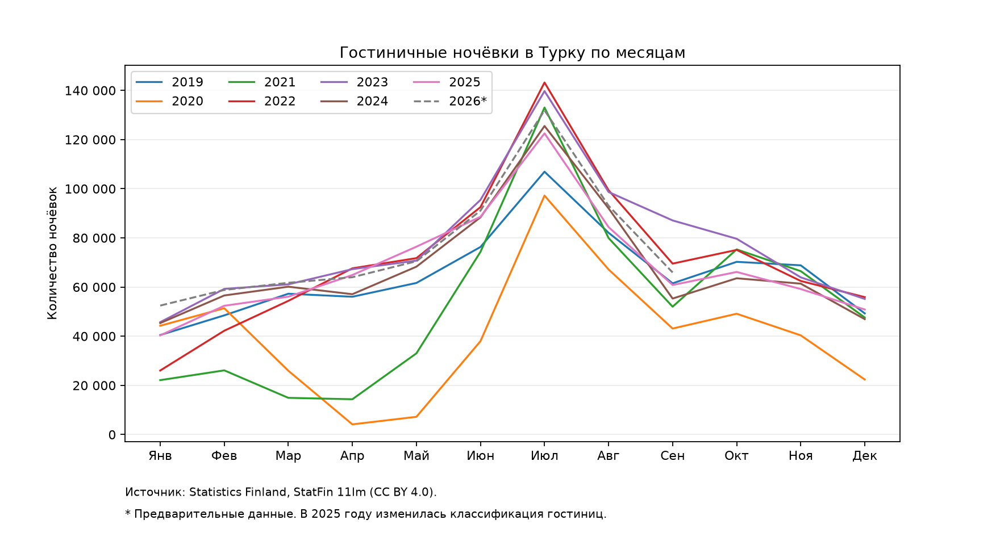
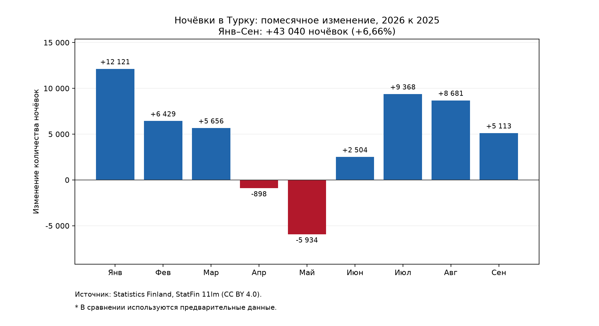
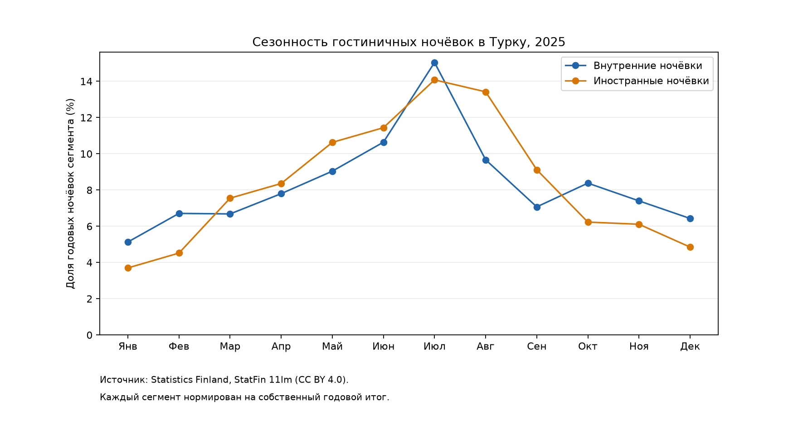

# Turku Business Intelligence

[Посмотреть дашборд в PDF — 3 страницы](turku_tourism_dashboard.pdf)

Проект демонстрирует полный цикл работы с открытыми данными: получение через API, сохранение исходных ответов, проверку качества, загрузку в PostgreSQL, построение аналитических моделей в dbt и обновление под управлением Airflow.

Главный вопрос анализа: **как изменились гостиничные ночёвки Турку относительно Тампере и Оулу и какой вклад внесли внутренние и иностранные ночёвки?**

За январь–сентябрь 2026 к тем же месяцам 2025: Турку **+6,66%**, Тампере **+0,49%**, Оулу **+13,40%**. В Турку прирост почти поровну распределён между внутренними и иностранными ночёвками; у Оулу преобладает внутренний сегмент. Причины различий не установлены. [Сравнение городов, методика и ограничения](reports/city_comparison.md).

Проект предназначен для DE / DA портфолио: воспроизводимый пайплайн, SQL-анализ и Power BI.

## Первый аналитический результат

В каждом полном году с 2019 по 2025 максимум гостиничных ночёвок в Турку пришёлся на июль. Это показывает сезонность гостиничного спроса, которую следует учитывать при анализе туристического рынка.



На 19 ноября 2026 года загружены 279 строк: по 93 месяца (2019-01—2026-09) для Турку, Тампере и Оулу. При последующих обновлениях пайплайн запрашивает данные по последний опубликованный месяц.

Источник — [Statistics Finland, StatFin 11lm](https://pxdata.stat.fi/PXWeb/pxweb/en/StatFin/StatFin__matk/11lm.px), лицензия CC BY 4.0.

Ограничения показателя:

- Гостиничные ночёвки измеряются в ночёвках, а не в уникальных туристах.
- Данные за 2026 год предварительные и могут пересматриваться.
- В 2025 году изменилась классификация гостиниц, поэтому сравнение объёмов с более ранними годами требует осторожности.

## Динамика гостиничных ночёвок

За январь–сентябрь 2026 года зарегистрировано 689 463 гостиничные ночёвки против 646 423 за те же месяцы 2025 года. Прирост составил **43 040 ночёвок, или 6,66%**.

Рост наблюдался в семи из девяти месяцев. Самый большой абсолютный прирост пришёлся на январь: **+12 121 ночёвка**. В апреле и мае показатели снизились; суммарное снижение за эти два месяца составило **6 832 ночёвки**.



Сравниваются одинаковые календарные месяцы. Данные 2026 года предварительные и могут пересматриваться. Расчёт описывает изменение гостиничных ночёвок за одинаковые периоды.

График строится из PostgreSQL и обновляется задачей Airflow `plot_monthly_change`. Успешный запуск всей цепочки из семи задач подтверждён 18 ноября 2026 года.

## Внутренние и иностранные ночёвки

За январь–сентябрь 2026 года внутренние ночёвки выросли на **21 354 (+3,96%)**, иностранные — на **21 686 (+20,28%)** относительно тех же месяцев 2025 года. Доля иностранных ночёвок увеличилась с **16,54% до 18,65%**.

В 2025 году июнь–август дали **35,36%** годовых внутренних ночёвок и **38,94%** иностранных. Каждый сегмент на графике нормирован на собственный годовой итог.



График выбирает последний год с 12 месяцами данных. При наличии предварительных значений он отмечает год звёздочкой и выводит предупреждение.

Подробные результаты и ограничения: [аналитический отчёт](reports/tourism_findings.md).

## Как устроен пайплайн

```text
StatFin API
    → исходный JSON и CSV
    → проверка качества данных
    → PostgreSQL: public.hotel_nights_monthly
    → dbt: marts.stg_statfin_hotel_nights
    → dbt: marts.tourism_seasonality
    → dbt: marts.tourism_city_comparison
    → три теста dbt и SQL-контроль
    → три графика
```

Исходные ответы API сохраняются отдельными JSON-файлами с временем получения в `data/raw/statfin/`.

CSV `data/hotel_nights_monthly.csv` содержит `municipality_code`, месяц, три счётчика ночёвок, признак предварительности и время получения в UTC. Коды: 853 — Турку, 837 — Тампере, 564 — Оулу. Каждый город должен иметь одинаковые последовательные месяцы с 2019-01. Старая выгрузка `turku_hotel_nights.csv` заменена этим файлом; прежние исходные JSON сохранены.

В PostgreSQL одна запись соответствует муниципалитету и месяцу. Повторная загрузка того же CSV не создаёт дубликатов. Более свежая выгрузка позволяет обновлять ранее опубликованные значения.

## Модели dbt

Источник dbt — таблица `public.hotel_nights_monthly`, которую наполняет Python-загрузчик.

Модели:

- `marts.stg_statfin_hotel_nights` — исходные показатели с выделенными годом и номером месяца.
- `marts.tourism_seasonality` — витрина с тремя показателями ночёвок, количеством месяцев в году, признаком полного года, годовой суммой, долей каждого месяца и долей иностранных ночёвок.

Годовая сумма и месячные доли рассчитываются только для годов с 12 месяцами данных. Для неполного года эти показатели остаются пустыми.

- `marts.tourism_city_comparison` — суммы за наблюдаемый год, те же месяцы предыдущего года, рост, доли и вклад сегментов в процентных пунктах.

Все три модели создаются как представления PostgreSQL.

## Как воспроизвести результат

Необходимы Python 3.14 и работающий Docker Desktop.

В корне проекта создай файл `.env` и задай в нём пароль PostgreSQL:

```dotenv
TURKU_POSTGRES_PASSWORD=your_local_password
```

Замени `your_local_password` собственным паролем. Файл `.env` исключён из Git через `.gitignore`.

Выполни команды из корня проекта на Windows:

```powershell
py -3.14 -m pip install matplotlib==3.11.2 "psycopg[binary]==3.3.9" python-dotenv==1.2.4
docker compose up -d --build
py -3.14 ingestion/refresh_statfin.py
```

Пайплайн последовательно:

1. Получает данные StatFin с января 2019 года по последний опубликованный месяц.
2. Сохраняет исходный ответ и CSV.
3. Проверяет качество CSV.
4. Загружает данные в PostgreSQL.
5. Строит три модели dbt, выполняет три теста dbt и SQL-проверки.
6. Строит три графика из витрины PostgreSQL.

Графики сохраняются в:

```text
reports/turku_hotel_nights_seasonality.png
reports/turku_hotel_nights_monthly_change.png
reports/turku_hotel_nights_segment_seasonality.png
```

В Compose настроена проверка готовности PostgreSQL; Airflow запускается после успешной проверки.

dbt установлен внутри контейнера Airflow. Скрипт `build_marts.py` поддерживает запуск из Windows и внутри контейнера.

Для отдельной сборки моделей и запуска проверок:

```powershell
py -3.14 ingestion/build_marts.py
```

## Обновление через Airflow

DAG `turku_tourism` выполняет семь последовательных задач:

1. `extract_statfin` — получение общих, внутренних и иностранных ночёвок, сохранение исходного ответа и CSV.
2. `check_data_quality` — проверка CSV перед загрузкой.
3. `load_postgres` — загрузка данных в PostgreSQL.
4. `build_marts` — построение трёх моделей dbt и выполнение трёх тестов.
5. `plot_seasonality` — график общей сезонности по годам.
6. `plot_monthly_change` — график изменений относительно тех же месяцев предыдущего года.
7. `plot_segment_seasonality` — сравнение сезонности внутренних и иностранных ночёвок.

После запуска контейнеров проекта интерфейс Airflow доступен локально по адресу `http://localhost:8080`.

18 ноября 2026 года подтверждён успешный ручной запуск всех семи задач прежней одно-городской версии с 93 месяцами в витрине.

Настроено ежедневное расписание на **01:20 по Москве** (`20 1 * * *`, Europe/Moscow).
19 ноября 2026 года подтверждён фактический запуск типа scheduled прежней одно-городской версии: все семь задач завершились успешно (01:20:01—01:21:54 по Москве), две модели и два теста dbt прошли, CSV и три графика обновились.
Первая попытка подключения к StatFin завершилась таймаутом; автоматический повтор прошёл успешно.
Подробности: [проверка запуска по расписанию](reports/scheduled_run_verification_2026-11-19.md).

Для выполнения расписания должны работать компьютер, Docker Desktop и контейнеры проекта.

## Проверки качества данных

До загрузки в PostgreSQL задача `check_data_quality` проверяет:

- наличие строк и непрерывность месяцев с января 2019 года для каждого города;
- отсутствие повторяющихся пар муниципалитет/месяц;
- целые неотрицательные значения общих, внутренних и иностранных ночёвок;
- равенство суммы внутренних и иностранных ночёвок общему итогу;
- допустимость признака предварительных данных.

Текущий набор содержит 21 Python-тест контракта данных и разбора JSON-stat: пустые данные, отрицательные значения, повторы, пропуски месяцев и городов, отсутствующие показатели, несовпадающие суммы сегментов и порядок измерений.

Запуск:

```powershell
py -3.14 -m unittest discover -s tests -v
```

При выполнении `dbt build` запускаются три теста:

- `check_tourism_seasonality` — проверяет месяцы и годовые доли. Для полного года сумма долей должна составлять около 100% с допуском 0,06 процентного пункта; для неполного года доли остаются пустыми.
- `check_tourism_segments` — проверяет заполненность и неотрицательность сегментов, соответствие их суммы общему итогу и допустимые границы доли иностранных ночёвок.

- `check_city_comparison` — три города с одинаковыми периодами, наличие базы сравнения, равенство сумм сегментов и вкладов общему росту.

В PostgreSQL также заданы ограничения на заполненность, неотрицательность и сумму показателей.

Ошибка сборки или теста приводит к ошибке задачи `build_marts` и блокирует последующее построение графиков.

## Проверка обработки сбоя

Проверена имитированная ошибка получения данных с параметром DAG:

```json
{"simulate_source_failure": true}
```

Airflow выполнил три неудачные попытки первой задачи. Последующие задачи не запускались. Ранее загруженные 93 записи в PostgreSQL, CSV и график той одно-городской проверки сохранились.

После выключения имитации новый запуск завершился успешно.

## Проверка расширения на три города

19 ноября 2026 года получен свежий ответ API на 279 строк. В отдельной пустой базе загрузка дала 279 изменений, повтор и попытка загрузить старый снимок — 0. Три модели и три теста dbt прошли (**PASS=6**); 21 Python-тест проверяет контракт и JSON-stat. Все 93 прежних значения Турку сохранены; три графика заново построены из расширенной витрины. Полный ручной запуск Airflow 19 ноября 02:08:30—02:08:51 прошёл с первой попытки во всех семи задачах. Сведения об обновлении рабочей базы и границах проверки — [отчёт](reports/city_comparison_verification_2026-11-19.md).

## Историческая проверка запуска на пустой базе (один город)

19 ноября 2026 года прежняя версия с внутренними и иностранными ночёвками проверена на новой базе `turku_bi_bootstrap_20261119_acc65934`, созданной из `template0`.
До загрузки в ней не было пользовательских объектов.

- Python-загрузчик создал таблицу и загрузил 93 месяца; повтор того же CSV изменил 0 строк.
- dbt создал две модели и выполнил два теста: **PASS=4 WARN=0 ERROR=0**.
- Восемь Python-тестов прошли; восемь недопустимых операций отклонены ограничениями PostgreSQL.
- Все три графика построены из новой витрины в отдельной папке.
- Данные рабочей базы, код, исходные файлы, существующие графики и dbt-артефакты во время проверки не изменились.

Проверен путь от сохранённого CSV до витрин и графиков в существующих контейнерах. Это не проверка полного развёртывания на новом компьютере или запуска Airflow по расписанию.
Исторический запуск 18 ноября до добавления сегментов завершился с PASS=3; текущий результат с двумя тестами — PASS=4.

Подробности и границы проверки: [отчёт о запуске на пустой базе](reports/bootstrap_verification_2026-11-19.md).
База выбирается переменной `TURKU_POSTGRES_DB`; значение по умолчанию — `turku_bi`. При тесте переменная задавалась только тестовым процессам.

## Дашборд Power BI

В корне проекта сохранён `turku_tourism_dashboard.pbip` и соседние папки `.Report` и `.SemanticModel`.

- **01 · Обзор**: выбор года, объёмы сегментов, доля иностранных, изменения за одинаковые месяцы предыдущего года и два помесячных графика.
- **02 · Сезонность**: только полные годы, летние доли и месячные профили сегментов Турку.
- **03 · Сравнение городов**: объёмы, рост и структура по трём городам, вклад сегментов и нормированные профили полного года.

Первые две страницы ограничены Турку на уровне страницы; общего фильтра по Турку у отчёта больше нет.

Открой `.pbip` в Power BI Desktop. После обновления базы через Airflow нажми «Обновить» в Power BI: импорт отчёта не обновляется автоматически вместе с PostgreSQL.
Подключение использует локальную базу `127.0.0.1:5433`, `turku_bi`. Для обновления нужны работающие PostgreSQL и Docker.

19 ноября файлы проверены по схемам Microsoft, модель прочитана библиотекой Analysis Services, меры выполнены запросами только на чтение на локальном движке Power BI и сверены с PostgreSQL.
Дашборд содержит три страницы. Все 31 мера проверены запросами DAX: 612 числовых сверок прошли. Итоговый PDF проверен на всех трёх страницах; значения совпадают с SQL. Для просмотра можно открыть PDF по ссылке в начале README или проект PBIP в Power BI Desktop.

Описание расчётов и контрольные значения: [Power BI](reports/powerbi_dashboard.md).
Исходный `.pbix` сохранён как прежняя версия; изменения PBIP не обновляют его автоматически.

## Языковые версии

English version: [Turku Tourism Intelligence — English repository](https://github.com/YaraBykova/turku-tourism-intelligence-en).

Обе версии содержат одинаковые данные и расчёты.
